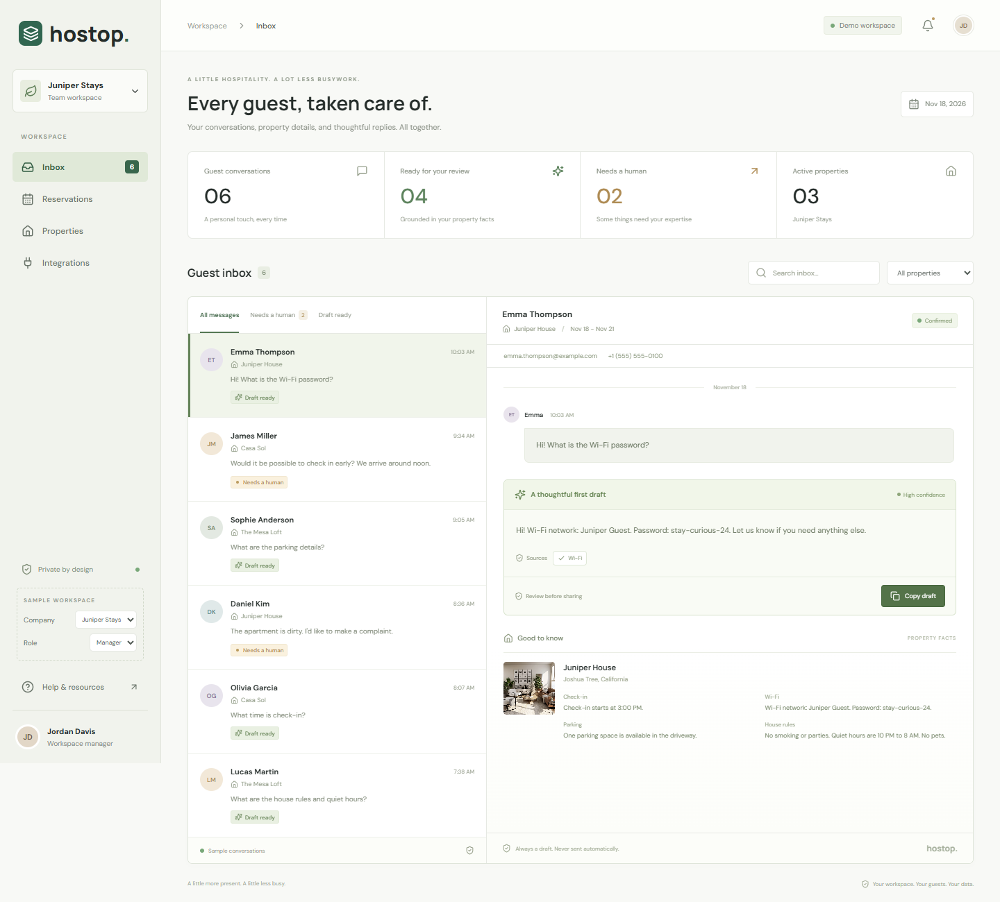
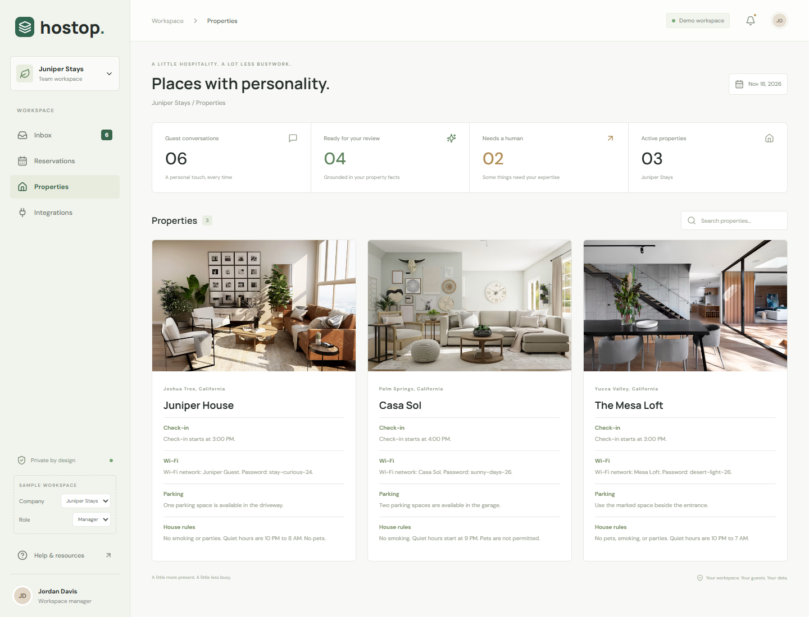
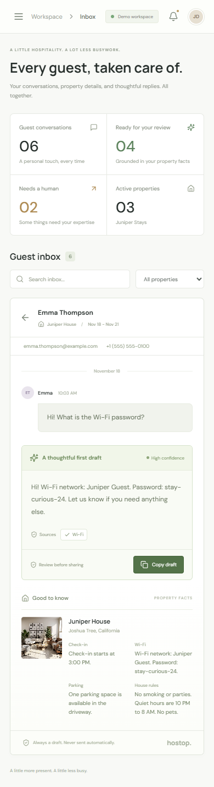

# HostOp

A multi-tenant guest-messaging workspace for short-term rental teams, built with Next.js App Router, TypeScript, Supabase Postgres/Auth/RLS, and Stripe test-mode Checkout. It brings together guest conversations, property-grounded reply drafts, reservations, signed PMS integrations, and private guest purchase links.

## Interface Preview



The screenshots show fictional guests in the sample workspace. Real login, tenant access, and checkout require configured Supabase and Stripe services.

<details>
<summary>Property facts and mobile conversation views</summary>

### Property Facts



### Mobile Inbox



</details>

## Run

Requires Node.js 22.18+ and npm.

```sh
npm install
npm run dev
```

Open http://127.0.0.1:3000. Without Supabase credentials the first screen is an explicitly labeled sample workspace. Its company/role selectors demonstrate presentation only, not security. Search, filters, navigation, conversation selection, and copying drafts work without services. Demo data is never written to a database. Sample photos are illustrative Unsplash interiors, not photographs of real listed properties.

## UI Walkthrough

1. Open http://127.0.0.1:3000. With no Supabase configuration, expect the Juniper Stays sample inbox and six conversations.
2. Select **Emma Thompson**. Her Wi-Fi question should show a draft containing only the Juniper House network/password, a **Wi-Fi** citation, and **High confidence**. Compare the citation and reply with **Good to know** below. **Copy draft** should copy text, never send a message.
3. Select **James Miller**. His early-arrival request must show **Needs a human**, no generated reply, and no copy/send action. Select **Daniel Kim** to check complaint escalation too.
4. Click **Needs a human** and **Draft ready**. Expect two and four sample conversations respectively. Return to **All messages**. Search `Emma`, then clear it. Select a property filter and confirm the list narrows.
5. Visit **Reservations** and **Properties**. Compare property-specific Wi-Fi and check-in facts. Return to the Inbox.
6. In the lower-left **Sample workspace** controls, switch to **Shore & Stay**. Expect different guest names and property names. Switch back to **Juniper Stays**.
7. Change sample **Role** to **Cleaner**. Expect the reservations view, no inbox navigation, no messages, and no email/phone display. Restore **Manager**. These controls demonstrate UI states; they are not proof of RLS.
8. Narrow the browser to a phone width. Open navigation with the menu icon, enter Inbox, open a conversation, and return using its back arrow. Check for clipped text or horizontal page overflow.
9. After connecting/seed-provisioning Supabase, use separate private browser sessions for the two managers and a cleaner. The real UI must have no sample role/company selectors. Verify tenant-specific properties, cleaner same-day stays only, and manager-only guest contacts. Run `npm run test:db` as the stronger direct-database security check.
10. After Stripe setup, generate a private link using `npm run guest-link -- 40000000-0000-0000-0000-000000000001`. Open it signed out, complete test Checkout, and wait for the webhook before expecting confirmation. A success URL alone must not confirm payment. Redeliver that actual Stripe event; the add-on should remain confirmed once, with one payment row.

### Connect Supabase

1. Install the Supabase CLI and Docker Desktop (or use a hosted Supabase project).
2. Copy `.env.example` to `.env.local` and fill in the values. Never expose the service-role key, webhook secrets, or Stripe secret key as `NEXT_PUBLIC_*` variables.
3. Locally run `npx supabase start`, then `npx supabase db reset`. Copy the local API URL, anon key, and service-role key from `npx supabase status` into `.env.local`.
4. Set `SEED_PASSWORD` in `.env.local` to a new password of at least 12 characters. Run `npm run provision` once against the seeded database. This creates `manager@juniper.example.com`, `cleaner@juniper.example.com`, `manager@shore.example.com`, and `cleaner@shore.example.com`, all using that password. Do not provision sample users on a production database.
5. Restart the app. Supabase configuration switches the app to real login and RLS-backed queries; the demo role/company switches disappear. A configured but unavailable database fails with an error, never with sample data.

For hosted Supabase, run `npx supabase login`, `npx supabase link --project-ref YOUR_REF`, and `npx supabase db push`. Apply `supabase/seed.sql` only to a disposable test project, then provision users. Disable public sign-up for the closed-company workspace. Memberships are admin-provisioned, never read from editable user metadata.

## Data Model And Security

`companies -> properties -> reservations -> messages`. Every entity carries a company ID. Composite foreign keys prohibit cross-company and cross-property relationships even for application bugs. `memberships` binds an Auth user to exactly one company and one of `manager`/`cleaner`. Supporting tables are `guest_contacts`, `webhook_events`, `guest_links`, and `payments`.

All nine tables have RLS enabled. Browser roles receive SELECT only on the six operational tables; no browser writes or integration RPC execution are granted. A pinned-search-path security-definer helper checks membership without recursive membership policies. Tenant policies remain in force when clients query Supabase directly.

- Managers see their own company's properties, reservations, messages, and contacts. They cannot see another company, even with guessed IDs, joins, or alternate filters.
- Cleaners see confirmed stays overlapping **today in the company's timezone**, including arrivals, in-house stays, and departures: `check_in <= today <= check_out`. Cancelled and future stays are excluded. They see only properties associated with those stays.
- Phone and email exist only in `guest_contacts`, whose SELECT policy requires Manager. Reservations have no contact columns to mask. Cleaners cannot read message bodies either: free-form guest text may itself contain contact details. Left joins cannot bypass contact RLS.
- Anonymous clients have no operational-table grants. `guest_links`, receipts, and payments have no client policies or grants. Only narrowly scoped server code uses the service key. Member sessions, not service keys, load the workspace.
- Private links are 256-bit random bearer capabilities. Only SHA-256 token hashes are stored, with seven-day expiry by default. Rotating a link invalidates the old token without clearing a payment/session. The guest page returns property/stay details only, not contact data. Pages have no-referrer, no-store, no-index, and anti-framing headers; no third-party analytics are included. Treat URL logs as sensitive and restrict/redact them at the hosting layer.
- Only provision trusted property facts and structured guest names. RLS cannot prevent a trusted upstream operator from putting an email in a name or a public property fact. Contacts and free-form messages are segregated to prevent the expected leakage path.

## Signed PMS Webhooks

POST `/api/webhooks/pms/<company-uuid>`. Each company has a separate secret in `PMS_COMPANY_SECRETS`, keyed by company UUID. There is deliberately no trusted company ID in the payload. Property external IDs must be provisioned first.

Headers: `x-pms-timestamp` (Unix seconds), `x-pms-signature` (hex HMAC-SHA256 of `timestamp + "." + exactRawBody`). Verification uses constant-time comparison and a five-minute replay window. Retries must be re-signed with a current timestamp. Payloads are capped at 64 KB after reading; add an ingress limit before the app in production.

```json
{
  "id": "evt-reservation-42-v3",
  "type": "reservation.updated",
  "version": 3,
  "data": {
    "id": "booking-001",
    "property_id": "juniper-house",
    "guest_name": "Emma Thompson",
    "check_in": "2026-11-17",
    "check_out": "2026-11-20",
    "status": "confirmed",
    "email": "emma@example.com",
    "phone": "+15555550100"
  }
}
```

For `message.updated`, `data` contains `id`, `property_id`, `reservation_id` (external booking ID), `body`, and ISO-8601 `sent_at`. Both event types require a nonnegative safe-integer `version`. The source contract is full entity snapshots with strictly increasing per-entity versions, not arrival timestamps or patches. A reservation cannot change property; rebooking uses a new external ID. Distinct content with an equal version is a provider contract violation; first accepted snapshot wins.

The `ingest_pms` Postgres function atomically records `(company_id,event_id)`, upserts the entity only when its incoming version is newer, and updates contacts in that same transaction. Concurrent requests serialize on unique constraints/row locks. Repeated event IDs return `duplicate`; older/equal entity versions return `stale`, both HTTP 200. No older contact values overwrite newer ones. PMS events never touch payment state.

A message arriving before its reservation gets HTTP 409. Its transaction, including receipt insertion, rolls back, so the exact event can be retried after the reservation arrives. Unknown properties also require provisioning/retry. Other transient DB failures return 503. The sender retries 409/503 responses with exponential backoff, preserving the original event ID and a fresh request signature.

Try duplicate/out-of-order requests against a running seeded stack:

```sh
npx tsx --env-file=.env.local scripts/send-pms.ts
npx tsx --env-file=.env.local scripts/send-pms.ts
npx tsx --env-file=.env.local scripts/send-pms.ts 10000000-0000-0000-0000-000000000001 older-event 1
```

## Grounded Drafting

The deterministic core retrieves only `check_in`, `wifi`, `parking`, and `house_rules` from the message's property. Reply content concatenates those **verbatim** values with fixed courtesy text. Each draft includes exact source key/value citations. It has no retrieval access to another property's facts and cannot manufacture a new price, time, policy, or promise.

Sensitive topics (refunds, damage, complaints and related keywords), instruction-like content, missing facts, unsupported clauses, and unrecognized specifics route to **Needs a human**, with null text, no citations, and confidence `none`. A deliberately narrow vocabulary sacrifices recall to avoid treating every mention of Wi-Fi as answerable. `high` is a categorical full-fact-coverage indicator, not a statistically calibrated probability. The corpus is English-only.

Optional `OPENAI_API_KEY` enables `gpt-4.1-mini` structured-output coverage checking on live, already-eligible drafts. The model sees only the guest message and that property's facts; it returns a boolean and fact keys, **never reply prose**. It can only veto the baseline. Key disagreement, invalid output, timeout, or model failure routes to a human. Without a key, the transparent deterministic baseline is used; the sample UI also uses this baseline. The test corpus evaluates that reproducible baseline, not a paid model run. Review data-handling consent before enabling the external model; guest messages may contain PII.

Drafts are regenerated from current property facts. Managers review and copy the suggested reply; the application exposes no send endpoint, making the no-auto-send guarantee structural.

## AI Evaluation And Tests

```sh
npm test
npm run test:db
npm run eval:ai
npm run typecheck
npm run lint
npm run build
```

The versioned 24-message corpus in `tests/fixtures.ts` specifies expected fact keys or human review for every input: four fact categories, combinations, sensitive topics, injection, mixed requests, early arrival, unsupported amenities, parking permits/cameras, and translation. The evaluator prints each outcome and the aggregate pass rate, exits nonzero on any failure, and verifies verbatim citation content. Unit tests additionally cover missing facts and cross-property grounding.

Database tests execute the actual migration in **PGlite (real PostgreSQL compiled to WASM)**, bootstrap the Supabase Auth UID function, then `SET ROLE authenticated` for both companies' managers and cleaners. They verify cross-tenant reads/writes/RPC denial, same-day scoping, contact denial even in joins, anonymous denial, duplicate/stale events, missing-parent rollback, amount/session validation, and once-only payment fulfillment. This is not a mocked query builder. It does not replace hosted Supabase/PostgREST, multi-connection concurrency, or end-to-end testing against Stripe.

### Verification

The focused automated suite passed **38 tests with zero failures** on Node.js 22.22.0. Coverage includes the actual database migration and RLS policies, all 24 evaluation messages, missing and cross-property facts, PMS signatures, and Stripe signatures. TypeScript validation also passes. Desktop and mobile UI captures are included in the interface preview.

## Stripe Test Checkout

1. Set a Stripe `sk_test_*` key. Live keys and live webhook events are rejected.
2. Run `stripe listen --forward-to http://127.0.0.1:3000/api/webhooks/stripe` and set its `whsec_*` secret, then restart Next.js.
3. Run `npm run guest-link -- 40000000-0000-0000-0000-000000000001`. Open the printed private URL without logging in.
4. Buy Early check-in using test card `4242 4242 4242 4242`, any future expiry and any CVC. Use Stripe CLI resend or the Stripe dashboard to redeliver the **actual session's** completed event; a synthetic unbound session must fail.
5. The success redirect only shows payment pending. Refresh after webhook delivery; only then should the database and guest page show confirmed.

Price/currency/quantity are fixed on the server: 4000 cents USD, one item, card-only. A durable reservation-based Stripe idempotency key and persisted Checkout session reuse prevent repeated clicks from creating multiple payments. A transactionally claimed first-attempt timestamp refuses an unresolved attempt after 23 hours, before Stripe's 24-hour idempotency retention guarantee lapses. An expired or ambiguous session is intentionally not replaced automatically: a host must reconcile it with Stripe. This favors avoiding a second payment over seamless recovery.

The raw-body Stripe signature is verified by the SDK. Only test-mode `checkout.session.completed`, `paid`, payment-mode, matching reservation metadata/client reference, expected add-on, amount, and currency are accepted. `confirm_payment` checks the stored session binding under a row lock, inserts a payment once (unique reservation, session, and event), and updates `early_check_in_paid` in the same transaction. Duplicate delivery returns success without a second mutation; webhook handling never creates a charge. An event arriving before session persistence returns 503 for Stripe to retry.

## Hosting

HostOp uses Vercel's Next.js deployment workflow. Environment variables are documented in `.env.example`; server credentials remain private and separate from browser-accessible configuration. Supabase migrations and seed data are versioned in `supabase/`.

## Future Enhancements

- **Live operations:** real-time inbox updates, conversation history pagination, team invitations, and multi-workspace accounts.
- **Review history:** saved draft edits, manager approvals, versioned property facts, and searchable activity records.
- **Guest services:** property-specific add-on availability, arrival-time selection, and expanded payment and refund workflows.
- **Messaging intelligence:** multilingual evaluation sets, broader intent coverage, and calibrated confidence scoring.
- **Integration operations:** queued event processing, delivery monitoring, and tools for reviewing and replaying events.